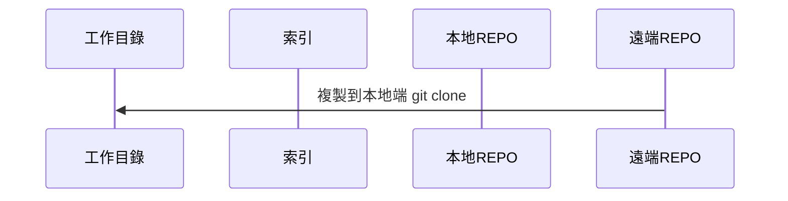
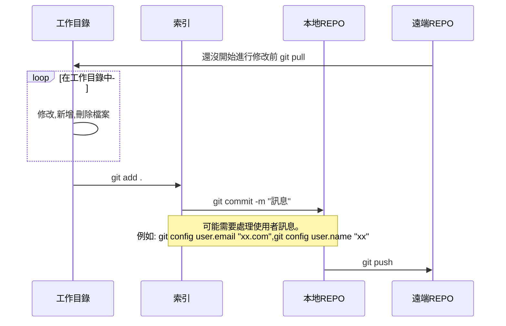

# 這是測試檔案

git 指令

- git init .
  在本地端子目錄,設定git的工作目錄
- git clone 網址
  - 範例: git clone https://github.com/airbone4/home2026.git

## 在codespace 中,我們需要的git 指令
   

推
- git add . 
  - git 就是通知git 軟體吃後面的指令, 加入所有有關目前子目錄的改變
- git commit -m "訊息"
- git push

拉

- git pull

#今日操作(2026/20/6)

## 操作1: 複製到本地端電腦修改

1. git clone https://github.com/airbone4/home2026.git
  進到工作目錄,然後打開vscode 新增,刪除,修改
1. git add .
1. git commit -m "update"
1. git push

> 問題: 當我打 git commit -m "demo from 教室上的機器" 顯示如下的訊息
> Author identity unknown
>
>*** Please tell me who you are.
>
>Run
>
>  git config --global user.email "you@example.com"
>  git config --global user.name "Your Name"
>
> to set your account's default identity.
> Omit --global to set the identity only in this repository.
>
> fatal: unable to auto-detect email address (got 'user@DESKTOP-LH2N1MN.(none)')

git config user.email "linchao@nkust.edu.tw"

git config user.name "linchao"

### clone指令以後
會在demo 子目錄中,產生home2026
你可以
- 操作1
  1. cd home2026
  1. code .
- 操作2
  1. code home2026
## 操作2

打開雲端機的第一個動作是同步檔案
1. 到終端機打入指令:
   git pull

## 觀念
以github repo 為中心,雲端機和本地機都是下指令
- git pull   

## 提要

### 在本地新建(複製)一個遠端REPO

### 在本地修改完成以後上傳

